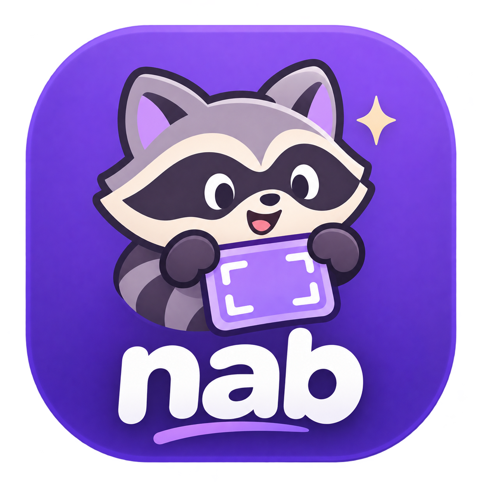
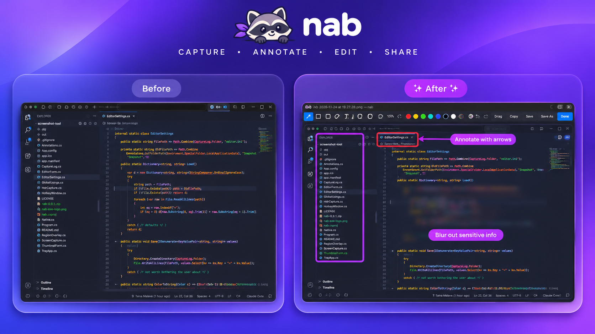
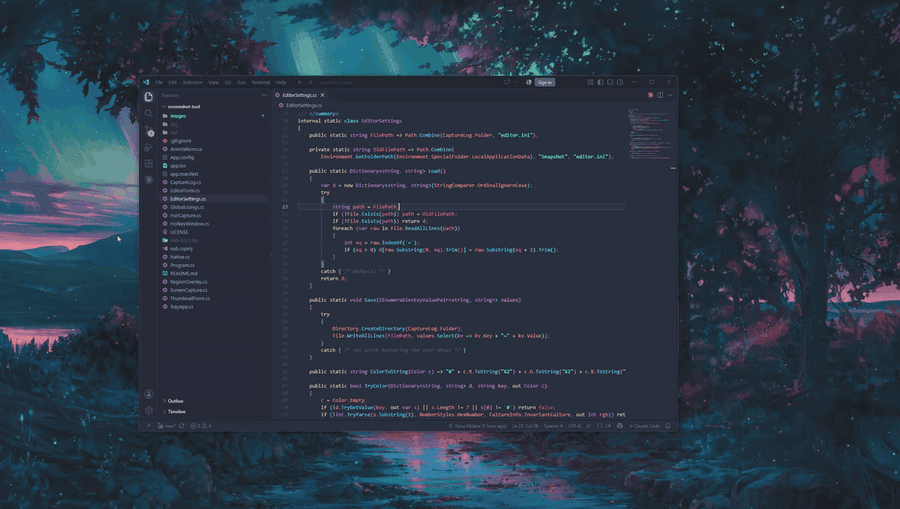
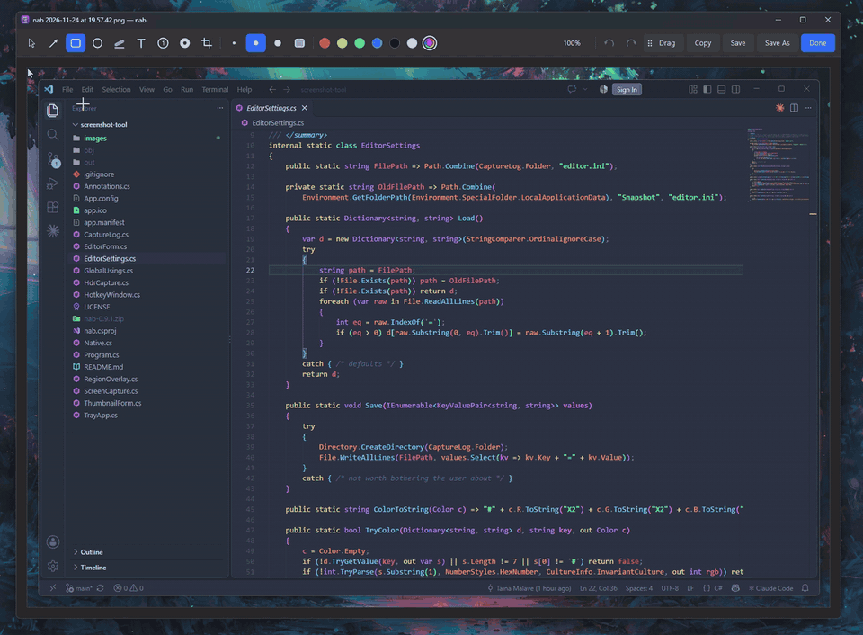
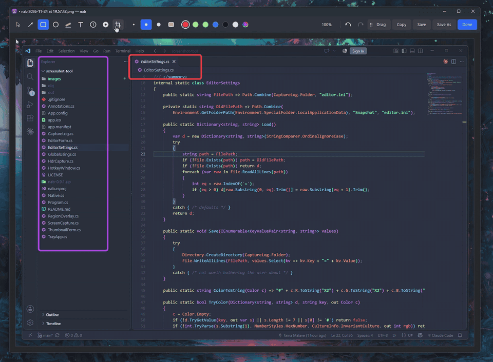
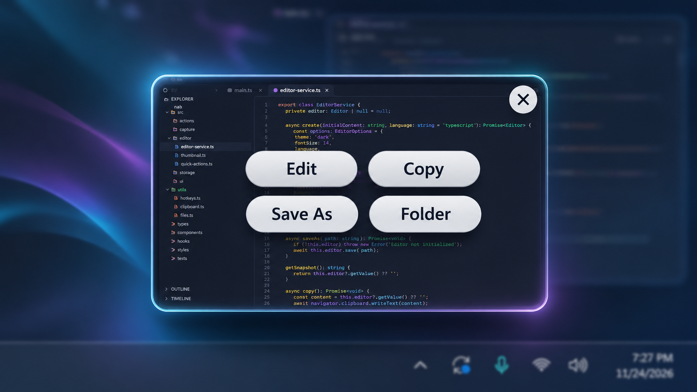
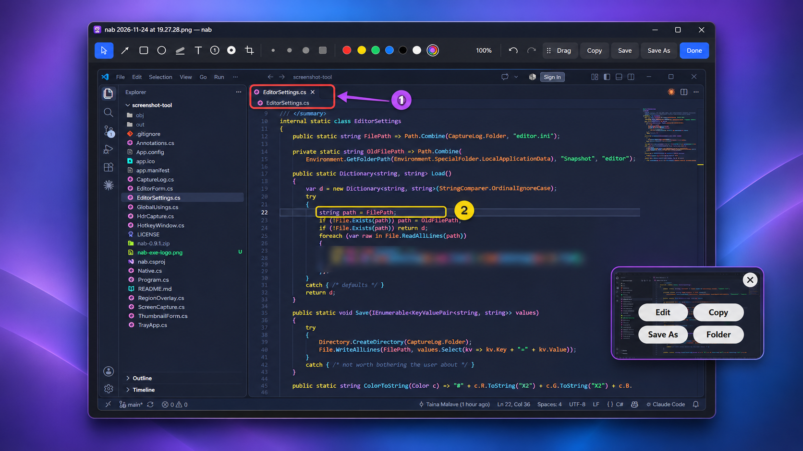

<div align="center">



# nab.

**See it. Nab it.**

A tiny, fast screenshot tool for Windows, with a built-in editor for arrows, text, highlights, numbered steps, blur and crop.

[](#requirements)
[](#building-from-source)
[](#building-from-source)
[](LICENSE)

[Download](#installation) · [Features](#features) · [Keyboard shortcuts](#keyboard-shortcuts) · [Build from source](#building-from-source)

<br>



</div>

## Features

- **Instant capture.** Grab a region or a whole monitor with one hotkey. The image is saved and copied to your clipboard right away.
- **Floating quick actions.** A small thumbnail pops up after every capture with Edit, Copy, Save As and Folder buttons.
- **Annotations.** Arrows (straight or curved), rectangles, ellipses, highlighter, text and numbered steps, in six colours plus any custom colour.
- **Blur and pixelate.** Hide passwords, emails and other private details. The blur is baked into the saved image, so it can't be undone.
- **Crop and edit later.** Crop to just the part that matters, then move, resize or restyle anything you drew.
- **Drag-and-drop sharing.** Drag a screenshot straight into Slack, Discord, an email or a browser upload box.
- **HDR support.** Screenshots from HDR monitors come out with normal colours instead of washed out.
- **Small and portable.** One ~400 KB exe. No installer, no account, no internet connection.

## Capture in seconds

Press **Ctrl+Shift+2**, drag over what you want, and let go. The screen freezes while you pick, so menus and tooltips stay put. Your screenshot is saved to `Pictures\nab` and copied to the clipboard, ready to paste.

<p align="center">
  
</p>

## Edit and annotate

Click **Edit** on the thumbnail (or double-click it) to open the editor. Point things out with arrows, box them in, highlight a line or number the steps. Everything you draw stays editable until you save: click a shape to move it, resize it or change its colour.

<p align="center">
  
</p>

## Protect sensitive information

Drag the blur tool over anything private. Press **F** to switch between a soft blur and a pixelated look. The blur is part of the saved image, so whoever receives it can't remove it.

<p align="center">
  
</p>

## Quick actions

After every capture, a thumbnail floats in the bottom-right corner. Hover over it to **Edit**, **Copy**, **Save As** (PNG or JPG) or open the **Folder**, or drag the thumbnail itself into another app to share the file. It never steals focus, so you can keep typing, and it disappears after a few seconds (hovering keeps it open).

<p align="center">
  
</p>

<p align="center">
  
</p>

## Installation

### Requirements

- Windows 10 (version 1903 or later) or Windows 11
- .NET Framework 4.8, which is already built into these versions of Windows

### Download and run

1. Download the latest `nab-X.Y.Z.zip` from the [Releases](https://github.com/TainaMalave/nab/releases) page.
2. Unzip it somewhere permanent, such as `Documents\nab`.
3. Double-click `nab.exe`. A raccoon icon appears in the system tray (check the `^` overflow arrow), and no window opens. That's it: nab is ready.

> [!NOTE]
> nab isn't code-signed yet, so Windows may show **"Windows protected your PC"** the first time. Click **More info**, then **Run anyway**. You can also right-click the zip before unzipping, choose **Properties**, and tick **Unblock**.

### Tips

- **Desktop shortcut:** right-click `nab.exe` → **Show more options** → **Send to** → **Desktop (create shortcut)**.
- **Start with Windows:** press **Win+R**, type `shell:startup`, and put a shortcut to `nab.exe` in the folder that opens.
- **Quit:** right-click the tray icon → **Exit**.

### Uninstall

Exit nab from the tray and delete its folder. nab doesn't write to the registry. If you want to remove everything, also delete `%LOCALAPPDATA%\nab` (settings and log). Your screenshots in `Pictures\nab` are yours to keep.

## Keyboard shortcuts

### Capturing (work anywhere)

| Action | Shortcut | Backup shortcut |
|---|---|---|
| Capture a region | <kbd>Ctrl</kbd>+<kbd>Shift</kbd>+<kbd>2</kbd> | <kbd>Ctrl</kbd>+<kbd>Alt</kbd>+<kbd>Shift</kbd>+<kbd>2</kbd> |
| Capture the monitor under the mouse | <kbd>Ctrl</kbd>+<kbd>Shift</kbd>+<kbd>1</kbd> | <kbd>Ctrl</kbd>+<kbd>Alt</kbd>+<kbd>Shift</kbd>+<kbd>1</kbd> |
| Cancel a region capture | <kbd>Esc</kbd> or right-click | |

If another app already uses a shortcut, nab switches to the backup one. The startup message and the tray menu show which shortcuts are active. You can also left-click the tray icon to capture a region.

### Editor tools

| Tool | Key | How to use it |
|---|---|---|
| Select | <kbd>V</kbd> | Click a shape to select it, then drag to move it or drag its handles to resize. Drag the middle handle of an arrow to bend it. |
| Arrow | <kbd>A</kbd> | Drag. Hold <kbd>Shift</kbd> to snap to 45°. <kbd>F</kbd> switches to curved arrows. |
| Rectangle | <kbd>R</kbd> | Drag. Hold <kbd>Shift</kbd> for a square. <kbd>F</kbd> = filled. |
| Ellipse | <kbd>E</kbd> | Drag. Hold <kbd>Shift</kbd> for a circle. <kbd>F</kbd> = filled. |
| Highlighter | <kbd>H</kbd> | Drag freehand, or hold <kbd>Shift</kbd> for a straight line. |
| Text | <kbd>T</kbd> | Click and type. <kbd>Enter</kbd> starts a new line. <kbd>F</kbd> adds a coloured background. |
| Numbered steps | <kbd>N</kbd> | Click to drop 1, 2, 3… Numbers renumber themselves if you remove one. |
| Blur | <kbd>B</kbd> | Drag over private details. <kbd>F</kbd> switches to pixelate. |
| Crop | <kbd>C</kbd> | Drag the area to keep. <kbd>Enter</kbd>, <kbd>Esc</kbd> or <kbd>C</kbd> finishes. |

### Editor actions

| Action | Shortcut |
|---|---|
| Size small / medium / large | <kbd>1</kbd> <kbd>2</kbd> <kbd>3</kbd> |
| Toggle the tool's option (curved, filled, background, pixelate) | <kbd>F</kbd> |
| Undo / redo | <kbd>Ctrl</kbd>+<kbd>Z</kbd> / <kbd>Ctrl</kbd>+<kbd>Y</kbd> |
| Move the selected shape | Arrow keys (hold <kbd>Shift</kbd> for bigger steps) |
| Delete the selected shape | <kbd>Delete</kbd> |
| Copy the image | <kbd>Ctrl</kbd>+<kbd>C</kbd> |
| Save over the original | <kbd>Ctrl</kbd>+<kbd>S</kbd> |
| Save as a new PNG or JPG | <kbd>Ctrl</kbd>+<kbd>Shift</kbd>+<kbd>S</kbd> |
| Done (save, copy and close) | <kbd>Ctrl</kbd>+<kbd>Enter</kbd> |
| Zoom in / out | <kbd>Ctrl</kbd>+mouse wheel or <kbd>Ctrl</kbd>+<kbd>+</kbd> / <kbd>Ctrl</kbd>+<kbd>-</kbd> |
| Zoom to 100% / fit to window | <kbd>Ctrl</kbd>+<kbd>1</kbd> / <kbd>Ctrl</kbd>+<kbd>0</kbd> |
| Pan | Middle mouse button, or hold <kbd>Space</kbd> and drag |

The editor remembers your last tool, colour and size, even after a restart. To share an edited screenshot without saving it, drag the **Drag** button in the toolbar into another app.

## Settings

Open `nab.exe.config` (next to `nab.exe`) in Notepad, change a value, and restart nab.

| Setting | Default | What it does |
|---|---|---|
| `OpenEditorAfterCapture` | `false` | `true` opens the editor right after every capture instead of showing the thumbnail. |
| `HdrToneMap` | `hue` | How very bright HDR colours are brought into range. `hue` keeps their colour; `clip` matches Windows Snipping Tool. |
| `HdrBrightness` | `1.10` | Brightness of screenshots from HDR monitors (0.5 to 2.0). |

## Where your files go

| What | Where |
|---|---|
| Screenshots | `Pictures\nab\nab YYYY-MM-DD at HH.MM.SS.png` |
| Editor settings and capture log | `%LOCALAPPDATA%\nab` |
| Temporary copies from dragging an edited image | `%TEMP%\nab` (cleared after a day) |

nab works completely offline. It never connects to the internet and collects no data.

## Troubleshooting

<details>
<summary><b>Screenshots from my HDR monitor look washed out or too dark</b></summary>

nab captures HDR monitors in high precision and converts them to a normal image, using the same white level as Windows' **SDR content brightness** setting. A saved PNG will always look a little less punchy than HDR on screen. Try adjusting `HdrBrightness` in [Settings](#settings). For details on what happened during a capture, right-click the tray icon → **Open capture log**.
</details>

<details>
<summary><b>A game screenshot comes out black or wrong</b></summary>

Exclusive-fullscreen games can block screen capture. Switch the game to borderless or windowed fullscreen.
</details>

<details>
<summary><b>Excel's Ctrl+Shift+1 / Ctrl+Shift+2 shortcuts stopped working</b></summary>

While nab is running, it owns those shortcuts, so they don't reach Excel. Exit nab from the tray when you need them.
</details>

<details>
<summary><b>"nab is already running"</b></summary>

Only one copy of nab runs at a time. Look for the raccoon icon in the system tray, including under the `^` overflow arrow.
</details>

## Building from source

You need the [.NET SDK](https://dotnet.microsoft.com/download) (version 8 or newer). It builds the .NET Framework 4.8 app using reference assemblies from NuGet, so Visual Studio isn't required.

```bash
git clone https://github.com/TainaMalave/nab.git
cd nab
dotnet build -c Release -o out
```

The app is built to `out/nab.exe`. It only uses libraries that come with Windows, so there are no other dependencies.

<details>
<summary><b>Project structure</b></summary>

| File | What it does |
|---|---|
| `Program.cs` | Startup, single-instance check and DPI setup |
| `TrayApp.cs` | Tray icon and menu, hotkeys, capture flow, thumbnail stacking |
| `HotkeyWindow.cs` | Registers the global hotkeys |
| `RegionOverlay.cs` | The frozen, dimmed screen for picking a region |
| `ThumbnailForm.cs` | The floating thumbnail, its buttons and drag-to-share |
| `EditorForm.cs` | The editor window: toolbar, zoom and pan, text typing, undo, copy and save |
| `Annotations.cs` | The shapes (arrow, rectangle, ellipse, highlighter, step, blur, text) and how they draw |
| `EditorSettings.cs` | Remembers the editor's last tool, colours and size |
| `ScreenCapture.cs` | Screen grab, PNG saving and clipboard |
| `HdrCapture.cs` | HDR capture with DXGI Desktop Duplication and tone mapping to sRGB |
| `CaptureLog.cs` | The diagnostic capture log |
| `Native.cs` | Windows API declarations |

</details>

## Contributing

Found a bug or have an idea? [Open an issue](https://github.com/TainaMalave/nab/issues). Please include your Windows version and, for capture problems, the relevant lines from the capture log.

## License

Copyright (C) 2026 Taina Malave

nab is free software: you can redistribute it and/or modify it under the terms of the GNU General Public License as published by the Free Software Foundation, version 3 of the License or (at your option) any later version.

nab is distributed in the hope that it will be useful, but WITHOUT ANY WARRANTY; without even the implied warranty of MERCHANTABILITY or FITNESS FOR A PARTICULAR PURPOSE. See the [GNU General Public License](LICENSE) for more details.

<p align="center"><b>Just nab it.</b> 🦝</p>
